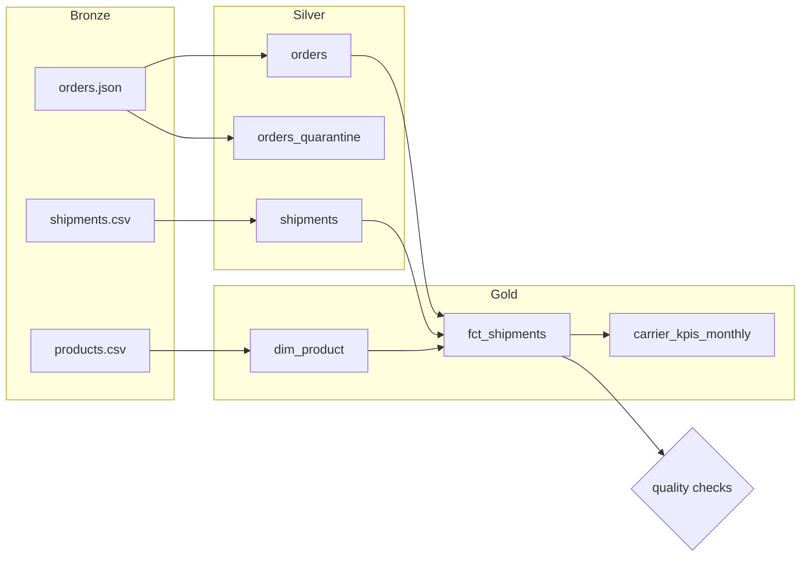

# PySpark Lakehouse Pipeline

[](https://github.com/Saigwe/pyspark-lakehouse-pipeline/actions/workflows/ci.yml)
 



A medallion-architecture (bronze → silver → gold) pipeline in **PySpark** that turns messy order and shipment feeds into a dimensional model and monthly delivery KPIs by warehouse and carrier.

The code runs locally and on **Databricks**: swap `.parquet(...)` for `.format("delta").save(...)`, or `saveAsTable(...)` for Unity Catalog tables.

## What it does

| Layer | Output | Logic |
|---|---|---|
| Bronze | `orders.json`, `shipments.csv`, `products.csv` | Raw feeds with realistic problems: duplicate events, blank quantities, unknown products, missing deliveries |
| Silver | `orders`, `orders_quarantine`, `shipments` | Explicit schemas, typed dates, deduplication. Bad rows are **quarantined with a reason**, not silently dropped |
| Gold | `dim_product`, `fct_shipments` (partitioned by warehouse), `carrier_kpis_monthly` | One row per shipment with on-time flag, days late and order value; a monthly KPI mart (on-time %, avg days late, delivered value) |

Quality checks run at the end, and the job exits non-zero if any fails: fact table not empty, unique `order_id`, no null order values, and quarantine under 5% of input.

## Run it

Requires Python 3.10+ and Java 17 or 21.

```bash
pip install -r requirements.txt
python -m lakehouse.pipeline --base data
pytest
```

## Tests

`tests/test_transforms.py` uses a local SparkSession to check deduplication and quarantine reasons, on-time and late flags (including undelivered orders), KPI aggregation, and a full end-to-end run on generated data. CI runs the tests on every push (`.github/workflows/ci.yml`).

## Design choices

- **Pure DataFrame functions.** Each transform takes and returns DataFrames, so it's testable without storage and portable to Databricks notebooks or jobs.
- **Explicit schemas** on raw JSON, so a source change fails loudly instead of being silently inferred.
- **Quarantine, don't drop.** Rejected rows keep a `reject_reason`, which makes data quality measurable and lets data owners fix the source.
- **Partitioning** the fact table by warehouse, the most common filter in downstream reporting.

## Stack

PySpark (Spark SQL functions), Parquet / Delta-ready, pytest, GitHub Actions.
